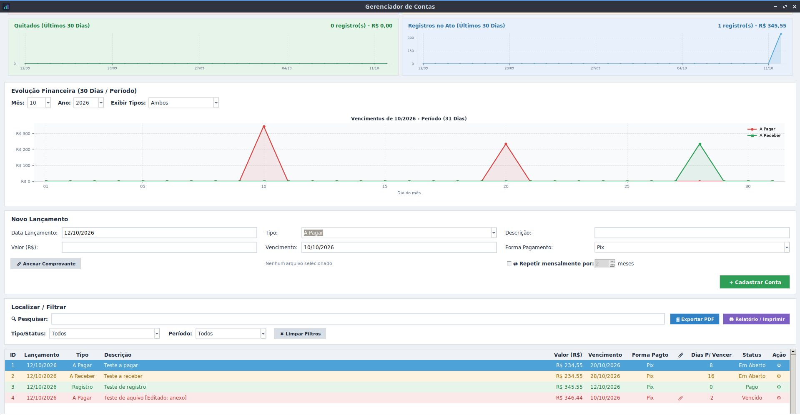

# 💰 Gerenciador de Contas Pessoais

Um sistema desktop leve, prático e intuitivo desenvolvido em **Python** para o controle financeiro pessoal. Gerencie **contas a pagar**, **contas a receber** e acompanhe o panorama geral das suas finanças com facilidade.

---

## 🚀 O que o projeto faz?
- **Controle de Contas a Pagar:** Organize seus compromissos financeiros e evite atrasos.
- **Controle de Contas a Receber:** Monitore entradas e receitas pendentes.
- **Registro Geral:** Mantenha um histórico claro e estruturado de todas as movimentações financeiras.
- **Visualização Gráfica:** Conta com gráficos dinâmicos gerados via *Matplotlib* para análise de dados.

---

## 📸 Captura de Tela

---

## 📋 Pré-requisitos
Antes de executar o aplicativo, certifique-se de ter instalado no seu computador:
1. **Python 3.x**
2. **Tkinter** (Interface gráfica padrão do Python)
3. **Matplotlib** (Biblioteca para gráficos financeiros)

---

## 🛠️ Instalação e Configuração

Você pode obter o projeto de duas formas:

### Opção 1: Baixando como ZIP (Para usuários finais)
1. Crie uma pasta no diretório local com o nome de **"Gerenciador de contas"** e extraia os arquivos nesta pasta.
2. Você pode executar o programa diretamente via linha de comando abrindo o terminal na pasta e digitando:python3 app.py
3. Para facilitar o acesso no dia a dia, execute o arquivo criar_atalho.py, que verificará os requisitos do sistema e criará um atalho automático na sua Área de Trabalho.
